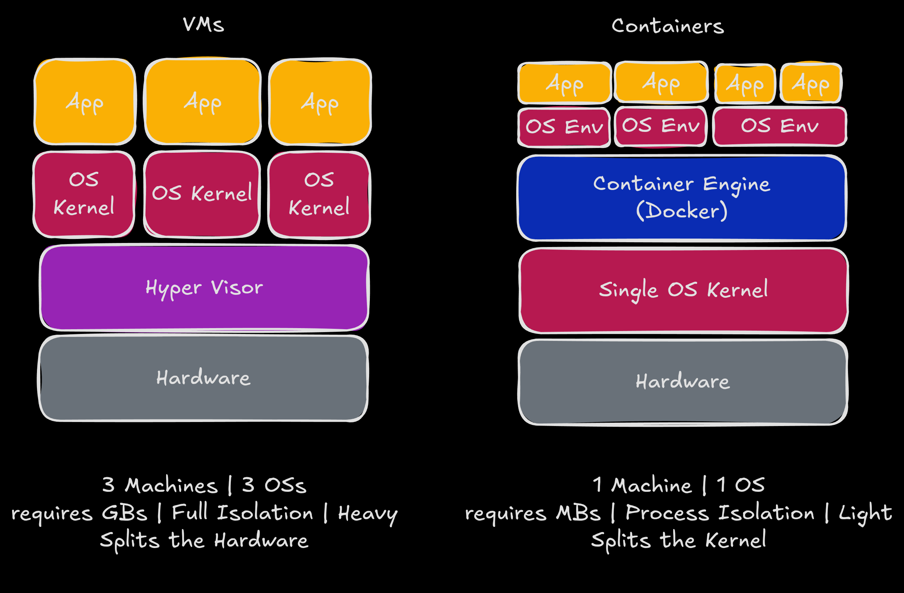
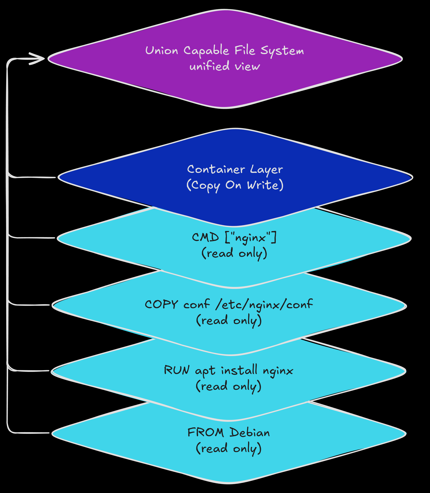
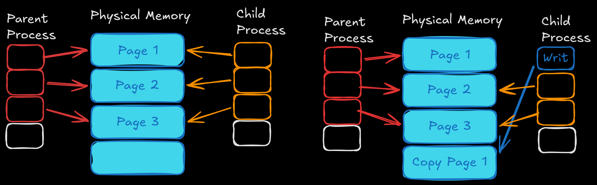
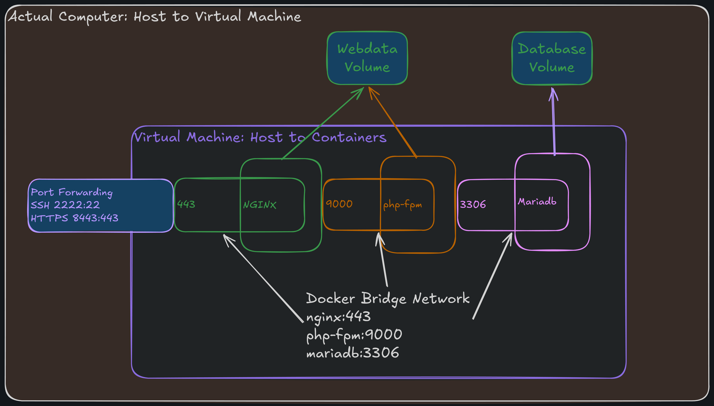

*This project has been created as part of the 42 curriculum by clouden*

# Description
------------
# ◦ Virtual Machines vs Docker
Both VMs and containers provide isolation and allow efficient sharing of host resources. They achieve this through different means.



**VMs** achieve this through virtualization of hardware into independently running machines. 

Each VM is responsible for running their own OS and kernel on top of a system program called a hypervisor. This introduces significant overhead in terms of system resources. 

As a result, VMs can be a lot more expensive than what is required by the processes running inside them. However, the VMs provide greater isolation which means more security.

**Containers**, on the other hand, achieve isolation by making each service/app its own process while sharing the hosts kernel. 

Each process is afforded its own OS user space environment This greatly reduces the demand on resources which makes containers more lightweight and agile compared to VMs, but slightly less secure because isolation happens only at process level, not kernel level.

---
**Containerization is based on Linux kernel features such as:** 
- cgroups
- namespaces
- and union capable file system.

**Cgroups** control how much system resources (CPU, I/O, and memory) a process has access to.

**Namespaces**  control what resources (such as other processes, mount points, hostnames, and network interfaces) a process can see. 

**Union capable files system** refers to how layers of a file system are presented as one unified view.

To understand what that means, we need to explain the Docker Lifecycle.

# Docker Layers, Images, and Containers
We start by writing the Dockerfile. Each line is an instruction that corresponds to one layer, where the first instruction is the lowest layer.

```
FROM debian:12
RUN apt install nginx
COPY conf/nginx.conf /etc/nginx/nginx.conf
CMD ["ningx" "-g" "daemon off;"]
```

This Dockerfile defines how to build each layer of a **Docker Image**.

Once the image is built then we can create one or many containers which can run separately from each other. Each one will have this same layered image as what is defined in the Dockerfile.

<p align="center">
  
</p>

Because of the **Union Capable File System**, Docker containers are able to see each layer as a unified view. Albeit these layers are read only and are only references to the sames resources that other containers spawned from the same image share.

These references save a considerable amount of resources since they refer to only one physical point in storage. But when one of the containers writes something, then a layer is added on top of the container that contains a modified copy of that data at a new location. 

This layer is called Copy on Write and is only visible from the container that wrote to it.

So each container will get its own copy of a resource when it modifies that resource. 



This layer is only available while the container is still running. Once the container stops the layer is removed and the data is lost. 

This leads us to the dilemma of data persistence, where we will discuss volumes and mounts.
## ◦ Docker Volumes vs Bind Mounts
Docker Volumes and Bind Mount both solve the same problem that containerization presents in regards to data persistence. 

Since the Copy on Write layer disappears the moment the container is stopped, anything that was written disappears disappears with it. 

The only way to make data persist is to set up Docker Volumes or Bind Mounts. These allow data to persist through starts and stops of containers by creating a shared directory both inside the container and on the host machine. 

So when the container is shut down the data persists in the host machine and is ready when the container restarts. This also allows multiple containers to access shared data. 

But containers are only aware of themselves and what they contain. PID1 is the service that is running. It does not know about any process outside of itself. That is why if the volumes did not exist externally from the containers then the shared data would be hidden from the other containers. 

The difference between volumes and bind mounts is the location and responsibility.

**Volumes** are stored inside the `.docker` directory on the host machine and Docker's API is soley responisible for creating and removing these directories. 

**Bind Mounts** are created and destroyed by the user outside the `.docker` directory somewhere else on the host machine's file system. Docker cannot create or destroy bind mounts. For example, we have been instructed to store data inside `/home/login/data` .

## ◦ Secrets vs Environment Variables
When storing sensitive information, such as database credentials, API keys and administrator passwords, it is important to keep these separate from application source code and Docker image metadata.

A common approach is to use environment variables, which can be defined in a `.env` file. This file allows configuration values to be kept outside the source code and should be excluded from version control using `.gitignore`.

However, environment variables are not a secure way of storing secrets, since their values can be exposed through container inspection or other processes.

Docker Compose provides a feature called **secrets**, which allows sensitive information to be made available to specific services as files, rather than passing the values directly as environment variables.

Secrets can be defined in the `docker-compose.yml` file and associated with individual services. The container can then access the secret through a mounted file, typically located in `/run/secrets/`.

This provides a clearer separation between ordinary application configuration and sensitive credentials. Secret source files should also be excluded from version control.
## ◦ Docker Network vs Host Network
A network name space is a Linux feature to provide an isolated network environment to single process or a group of processes.

So when Docker creates a container it receives its own network namespace. In our case each of our containers has its own network namespace.

The default network on Docker is a Bridge network which allows each container's network namespaces to communicate by using their container names as hostnames

The ports are identified with their service name defined in the docker-compose.yml. So in the mandatory project we have:
- nginx:443
- php-fpm:9000
- mariadb:3306



All of this is kept separate from the host network and ports, so used ports on the host do not interfere with the Docker network ports
# Instructions
--------------
1. `git clone` project to your machine
2. enter project directory
3. import your credentials `.env` file to `srcs`
4. import your `secrets/` directory to project root directory
5. run `make up` to start
6. run `make down` to stop
7. run `make fclean` to remove everything

# Resources
-------------
**Docker Compose Documentation**
https://docs.docker.com/compose/

**Docker Bridge Network Documentation**
https://docs.docker.com/engine/network/drivers/bridge/

**Docker Run Containers Documentation**
https://docs.docker.com/engine/containers/run/

**Docker Secrets Documentation**
https://docs.docker.com/engine/containers/run/

**NGINX Config Documentation**
https://docs.nginx.com/nginx/admin-guide/web-server/serving-static-content/

**FastCGI Params**
https://nginx.org/en/docs/http/ngx_http_fastcgi_module.html#fastcgi_param

AI was used to quickly reference the wide number of configurations and commands necessary to debug a variety of setup files. The number of required services increased the knowledge base and made failures very difficult to resolve. AI helped diagnose problems and careful notes were taken in order to get a foot hold on how to explore confirm the container system set up.

Also AI was very helpful in providing  answers to questions that help me deepen my grasp of the concept underlying the project.
